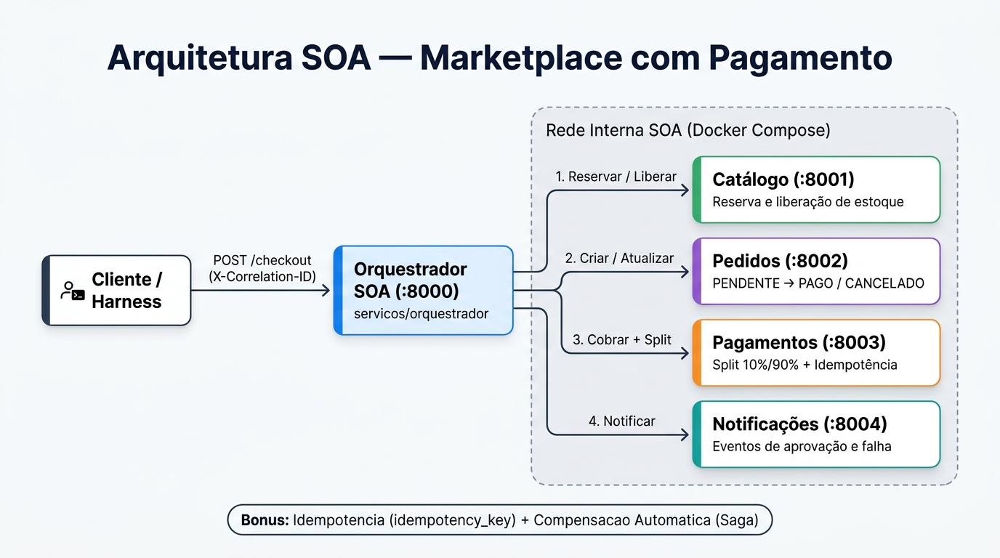
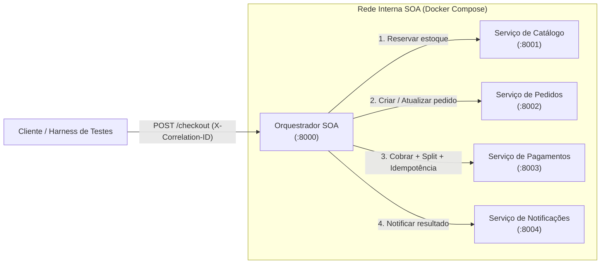

# Arquitetura do Sistema — Marketplace com Pagamento (SOA)

O sistema segue o padrão **Arquitetura Orientada a Serviços (SOA)**, com um **Orquestrador SOA** centralizando a composição de serviços independentes de negócio, contratos REST/OpenAPI explícitos, propagação de `X-Correlation-ID` e um **Harness de Verificação** automatizado.

## Componentes (`servicos/`)

| Componente | Porta | Responsabilidade |
| --- | --- | --- |
| `servicos/orquestrador` | `8000` | Barramento/Orquestrador SOA. Recebe a solicitação de checkout, coordena a saga (reserva → pedido → pagamento → confirmação/compensação) e propaga `X-Correlation-ID`. |
| `servicos/catalogo` | `8001` | Serviço de Catálogo e Vendedores. Mantém produtos, vendedores, estoque e operações de reserva/liberação. |
| `servicos/pedidos` | `8002` | Serviço de Pedidos. Cria pedidos (`PENDENTE`) e atualiza status (`PAGO` ou `CANCELADO`). |
| `servicos/pagamentos` | `8003` | Serviço de Pagamentos. Processa cobrança (PIX/Cartão), calcula split (10% marketplace / 90% vendedor) e garante **idempotência** via `idempotency_key`. |
| `servicos/notificacoes` | `8004` | Serviço de Notificações. Registra e emite notificações de aprovação ou falha/compensação para comprador e vendedor. |

## Diagrama de Arquitetura

## Desafio do Modelo (Bônus)

1. **Idempotência no Pagamento (`idempotency_key`):** Requisições repetidas com a mesma chave retornam a transação original sem efetuar nova cobrança nem novo split.
2. **Compensação Automática (Saga):** Se o pagamento for recusado (ex.: `simular_falha: true` ou cartão recusado), o Orquestrador desfaz a reserva de estoque no `catalogo`, atualiza o pedido para `CANCELADO` no `pedidos` e registra a notificação de falha no `notificacoes`.
3. **Harness Engineering:** Todos os serviços expõem `/health` (com `healthcheck` no `docker-compose.yml`), logs estruturados com `X-Correlation-ID` e um script de verificação (`scripts/harness.py`) que valida todos os cenários automaticamente.
